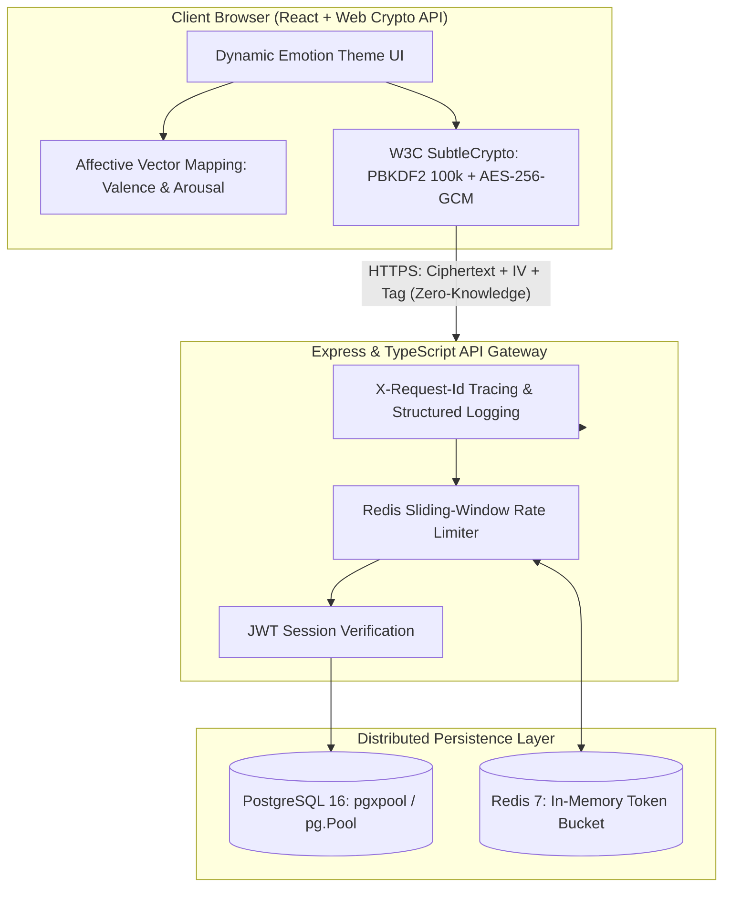

# Affective Vault: Privacy-Preserving Emotion Intelligence & Distributed Mood Telemetry

[](https://github.com/your-username/emoji-mood-diary/actions)
[](https://opensource.org/licenses/MIT)
[](https://www.typescriptlang.org/)
[](https://www.postgresql.org/)
[](https://redis.io/)

A zero-knowledge encrypted mental health tracking and affective computing platform. Combines **Russell's 2D Circumplex Model of Affect** with client-side **AES-256-GCM authenticated encryption**, connection-pooled **PostgreSQL** persistence, and a **Redis-backed distributed sliding-window rate limiter**.

---

## 🏛️ System Architecture



---

## 🔬 Scientific & Systems Foundations

### 1. Mathematical Formulation: Russell's Circumplex Model of Affect
Traditional mood trackers treat emotions as arbitrary discrete categorical labels. This system maps emotional states continuously onto a 2D Euclidean coordinate space:

$$\vec{E} = \begin{bmatrix} v \\ a \end{bmatrix} \quad \text{where } v \in [-1.0, 1.0], \; a \in [-1.0, 1.0]$$

* **Valence ($v$):** Quantifies pleasure vs. displeasure along the horizontal axis.
* **Arousal ($a$):** Quantifies activation/energy level along the vertical axis.
* **Quadrant Mapping:**
  * **$Q_1 (+v, +a)$:** High-activation positive affect (Joy, Excitement, Euphoria).
  * **$Q_2 (-v, +a)$:** High-activation negative affect (Anxiety, Anger, Tension).
  * **$Q_3 (-v, -a)$:** Low-activation negative affect (Sadness, Lethargy, Boredom).
  * **$Q_4 (+v, -a)$:** Low-activation positive affect (Calm, Serenity, Relief).

### 2. Cryptographic Protocol: Zero-Knowledge Client-Side AES-256-GCM
Because mental health reflections represent sensitive personal health information (PHI), the server is architected as an **untrusted ciphertext vault**:

1. **Key Derivation:** The client derives a 256-bit symmetric key locally using `PBKDF2`:
   $$K = \text{PBKDF2}(\text{passphrase}, \text{salt}, \text{iterations}=100000, \text{hash}=\text{SHA-256})$$
2. **Authenticated Encryption:** Each journal entry is encrypted with a fresh 96-bit Initialization Vector (`IV`):
   $$C, T = \text{AES-GCM-Encrypt}(K, IV, \text{plaintext})$$
3. **Integrity Verification:** The server persists only $\{IV, C, T, \text{date}, v, a\}$. Even a total database breach yields zero readable text.

### 3. Distributed Systems & Caching Layer
* **Connection Pooling:** PostgreSQL database queries leverage connection pooling (`pg.Pool`, max 20 connections) with composite indexing on `(user_id, entry_date DESC)` to prevent connection starvation under high concurrency.
* **Redis Sliding-Window Rate Limiter:** Protects auth and entry endpoints using atomic transaction pipelines (`MULTI`/`EXEC`) with a 60-second moving window.
* **Resilient Offline Fallback:** If the remote backend is unreachable, the client transitions seamlessly to local encrypted storage with zero degradation of user experience.

---

## 🚀 Quickstart & Deployment

### Option 1: Docker Compose (One-Command Startup)

```bash
# Clone the repository
git clone https://github.com/your-username/emoji-mood-diary.git
cd emoji-mood-diary

# Launch PostgreSQL, Redis, and Express API
docker compose up --build -d
```

### Option 2: Local Development

#### 1. Backend Server
```bash
cd server
npm install
npm run dev
# Server boots on http://localhost:5000
```

#### 2. Frontend Client
```bash
# In the root directory
npm install
npm run dev
# Frontend boots on http://localhost:5173
```

---

## 📡 API Endpoints

| Method | Endpoint | Description | Rate Limit |
| :--- | :--- | :--- | :--- |
| `GET` | `/health` | Health probe for Docker/K8s orchestrators | None |
| `POST` | `/api/auth/register` | Register user with client PBKDF2 salt | 15 req/min |
| `POST` | `/api/auth/login` | Authenticate and obtain JWT bearer token | 15 req/min |
| `POST` | `/api/entries` | Store zero-knowledge encrypted entry | 100 req/min |
| `GET` | `/api/entries` | Fetch paginated entry metadata & ciphertext | 100 req/min |
| `GET` | `/api/analytics/summary` | Query aggregated valence & arousal statistics | 60 req/min |

---

## 🛡️ Software Engineering Best Practices
* **Strict Type Safety:** Fully typed TypeScript backend with Zod schema validation.
* **Automated CI/CD:** GitHub Actions workflow verifying linting, compile integrity, and build checks on pull requests.
* **Defense-in-Depth:** HTTP security headers provisioned via Helmet, bounded request payload sizes, and parameterized SQL queries to prevent injection attacks.
